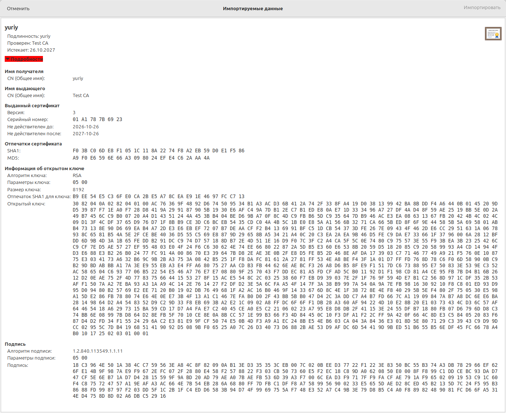

## Руководство по развёртыванию

### Подготовка ключа подписи
> keytool -genkeypair -alias pivkin -keyalg RSA -keysize 2048 -dname "CN=Test CA" -keystore signer.p12 -storetype PKCS12 -storepass testpassword -keypass testpassword

alias и пароль testpassword зашиты в `ServerMain.java`, на случай если хочется поиграться

### Сборка

Из корня проекта, там где pom.xml:

> mvn clean package

### Запуск сервера

issuer должен совпадать с указанным dname: 

> java -cp target/keygen-server-1.0.jar ServerMain \<port> \<workers> "\<issuer>"

Например:

> java -cp target/keygen-server-1.0.jar ServerMain 9000 4 "CN=Test CA"

### Запуск клиента

> java -cp target/keygen-server-1.0.jar ClientMain \<host> \<port> \<name> [--delay N] [--abort]

где

* `--delay N` - задержка в секундах между отправкой запроса и началом чтения ответа
* `--abort` - не читать ответ вообще, сразу закрыть соединение

Например: 

> java -cp target/keygen-server-1.0.jar ClientMain localhost 9000 yuriy

После успешного завершения в директории должны появиться `<name>.crt` и `<name>.key`

